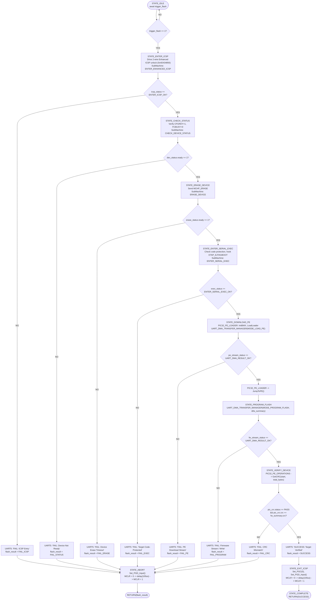

# FLASHER TOP — Diagram

Visual companion to [[../FLASHER_TOP]] (`PIC32_FLASH_ENGINE`, Microchip DS60001145U Figure 3-1).

**Notes**

- This is the master orchestration state machine — every box here delegates to one of the [[FLASHER_TOP|child SubMachines]] rather than doing hardware work directly, except for the final MCLR reset pulse shared by `STATE_EXIT_ICSP` and `STATE_ABORT`.
- `STATE_DOWNLOAD_PE` and `STATE_PROGRAM_FLASH` both call into [[Diagrams/UART DMA FUNC MANAGER]] — same engine, different `mode` argument and different destination for the streamed words (EJTAG FASTDATA vs. flash word-program).
- Every failure path converges on `STATE_ABORT`, which always tristates the data line and pulses `MCLR` regardless of *which* step failed — this is what keeps a half-programmed or half-unlocked target from being left in a stuck/undefined bus state.
- `STATE_VERIFY_DEVICE`'s CRC-16 compare is the other end of the running `transfer_crc` accumulated inside [[Diagrams/UART DMA FUNC MANAGER]] during `STATE_PROGRAM_FLASH`.
