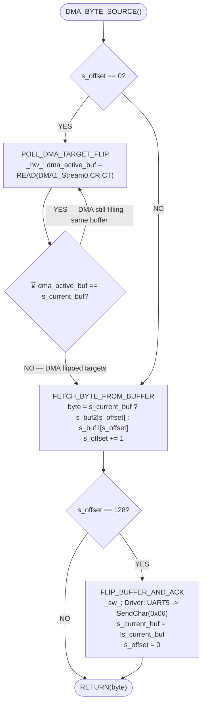

# NEXT BYTE — Diagram

Visual companion to [[DMA_BYTE_SOURCE]] (`NextByte()`).

**Notes**

- Entry condition `s_offset == 0` is the buffer-boundary check: the consumer only needs to confirm the DMA engine has moved on to the *other* buffer when it's about to start reading a fresh one.
- `POLL_DMA_TARGET_FLIP` is a tight spin-poll — it blocks until hardware (`DMA1_Stream0->CR.CT`) reports the opposite half of the ping-pong buffer is now the active DMA target, guaranteeing the half we're about to read is fully written and stable.
- The `0x06` (ACK) byte sent in `FLIP_BUFFER_AND_ACK` is the host-side pacing token — see [[HSI/DMA_PINGPONG_INTERFACE]] for the full handshake contract.
