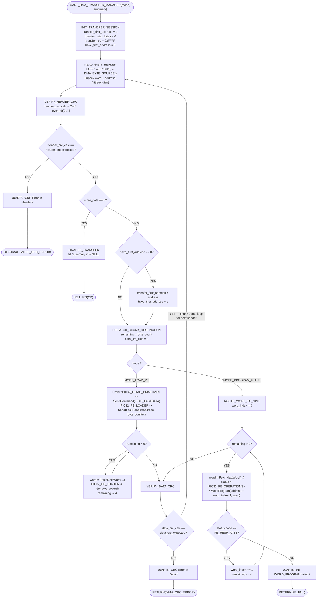

# UART DMA FUNC MANAGER — Diagram

Visual companion to [[SubMachines/UART_DMA_TRANSFER_MANAGER]] (`UART_DMA_RunTransfer()`).

**Notes**

- This is a single blocking loop: `READ_64BIT_HEADER` → `VERIFY_HEADER_CRC` → (dispatch one chunk) → `VERIFY_DATA_CRC` → back to `READ_64BIT_HEADER`, until a header arrives with `more_data == 0`.
- The two `mode` branches both pull bytes through the same `FetchNextWord` helper (4× [[Diagrams/NEXT BYTE|NextByte]] calls + running CRC-8/CRC-16 update) — they only differ in *where the resulting 32-bit word is sent*: EJTAG FASTDATA for PE bootstrap, or `PIC32_PE_OPERATIONS::WordProgram` for the real firmware payload.
- `transfer_crc` (CRC-16) accumulates across the **entire** transfer regardless of chunk boundaries — it's what [[SubMachines/PIC32_PE_OPERATIONS]]'s `GetCRC` result gets compared against in `STATE_VERIFY_DEVICE` back in [[Diagrams/FLASHER TOP]].
- Packet layout referenced here (`word0` bit-packing, header vs. data CRC placement) is defined in [[HSI/UART_PACKET_FORMAT]].
